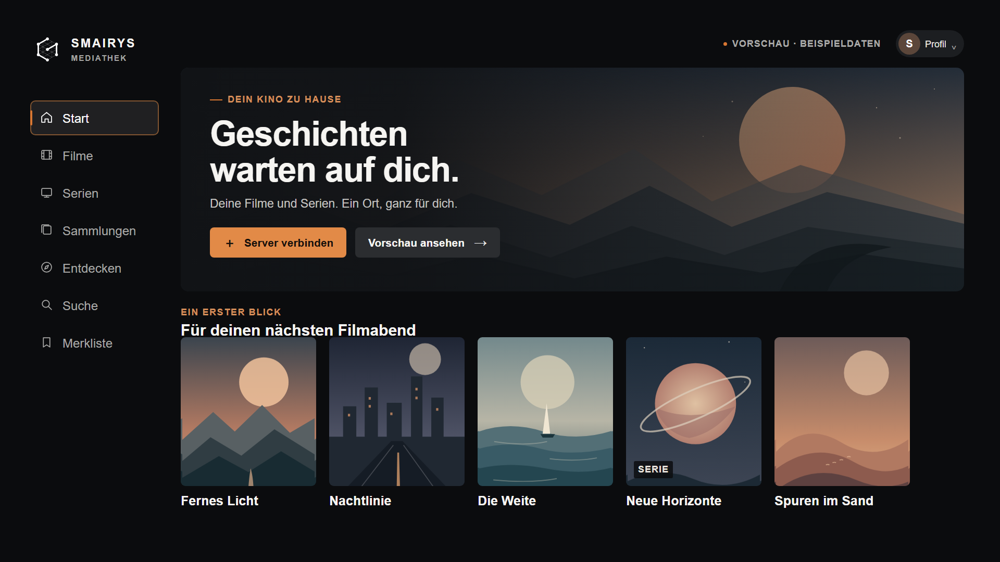

# Smairys Mediathek

**Deine freie Kinoerfahrung.** Ein eigener Jellyfin-Client für ältere Samsung Smart TVs – entwickelt für die Fernbedienung und Tizen 2.4.

> **Status:** Die neue TV-Oberfläche ist als Vorschau mit Beispieldaten umgesetzt. Phase 0 bleibt offen: Ein WGT-Build und ein Test auf dem Fernseher sind noch nicht erfolgreich durchgeführt. Die aktuelle SDK-Installation blockiert den Build.

> **Entwicklungsphase:** Das Projekt wird derzeit allein vom Inhaber entwickelt. Externe Beiträge, Issues, Pull Requests und Diskussionen werden vorerst nicht angenommen.



## Warum dieses Projekt?

Die Smairys Mediathek soll die eigene Jellyfin-Bibliothek auf dem Samsung UE65KU6099 (Modelljahr 2016) übersichtlich und bequem vom Sofa aus zugänglich machen. Jellyfin bleibt die Datenquelle für Bibliotheken, Benutzer, Metadaten und Medien. Diese App ist der TV-Client.

Die Vorschau enthält Start, Filme, Serien, Sammlungen, Entdecken mit Darsteller- und Duo-Beispielen, Suche und Merkliste sowie einen Dialog für die Serververbindung. Ihre Titel und Grafiken sind Beispieldaten; Suche und Merkliste arbeiten nur mit diesen Daten und die Merkliste bleibt nur während der Sitzung erhalten. Die Verbindungsprüfung fragt Jellyfin unter `/System/Info/Public` ab. Anmeldung, echte Bibliotheksdaten und Wiedergabe sind noch nicht implementiert.

## Zielgerät

| | Ziel |
| --- | --- |
| Fernseher | Samsung UE65KU6099UXZG, Modelljahr 2016 |
| System | Tizen 2.4.0 |
| WebEngine | WebKit r152340 |
| Anwendung | Tizen Web App, Paketformat `.wgt` |
| Backend | Jellyfin |

Die Oberfläche verwendet HTML, CSS und ES5-JavaScript ohne Framework. Desktop-Vorschau ist hilfreich für Layout und Logik, bestätigt aber keine Kompatibilität mit dem TV.

## Lokale Vorschau

Mit Node.js ab Version 22 im Projektordner den Vorschau-Server starten und `http://127.0.0.1:8000` im Browser öffnen:

```powershell
npm run preview
```

Im Prototyp wird die eigene Jellyfin-Adresse eingegeben. Es ist keine private Server- oder LAN-Adresse im Quellcode vorbelegt.

Die Vorschau lässt sich mit den Pfeiltasten, Enter und Escape bedienen. Über **Profil** oder **Server verbinden** öffnest du die Verbindungseinstellungen. Die Beispielkarten lassen sich öffnen und für die laufende Sitzung merken.

## Prüfungen, Build und TV-Test

Für die Entwicklungsprüfungen einmalig Abhängigkeiten und Testbrowser installieren:

```powershell
npm ci
npx playwright install --only-shell chromium
npm test
```

Die Prüfungen kontrollieren unter anderem ES5-Syntax, Manifest, Dateien, Branding und wichtige Bedienabläufe in einem Desktop-Browser. Sie belegen keine TV-Kompatibilität.

`npm run prepare:tizen` erstellt unter `.build/runtime` einen bereinigten Ordner mit den benötigten Laufzeitdateien. Er enthält noch kein WGT.

Voraussetzung ist ein funktionierendes Tizen Studio Web CLI mit Samsung TV Extension sowie ein gültiges Samsung-TV-Signaturprofil. Die momentan installierte Toolchain hat diese Voraussetzungen noch nicht erfüllt. Der bekannte Fehler und die Build-/Installationsschritte sind in [docs/PROJECT_CONTEXT.md](docs/PROJECT_CONTEXT.md) festgehalten.

Es wurde noch kein WGT erzeugt und keine App auf dem UE65KU6099 installiert. Der Abschnitt „Aktueller technischer Stand“ beschreibt den bekannten Blocker.

## Entwicklung und Zusammenarbeit

Der Quellcode ist öffentlich zur eigenen Nutzung vorgesehen. Während der Entwicklungsphase nimmt das ursprüngliche Projekt keine externen Beiträge an; Details stehen in [CONTRIBUTING.md](CONTRIBUTING.md). Öffentliche Repositories können trotzdem gelesen und geforkt werden.

Für die Entwicklung gelten die Grenzen des Zielgeräts: keine modernen Browser-APIs voraussetzen, bevor sie auf Tizen 2.4 geprüft wurden. Fokus und Fernbedienung haben Vorrang. Jede Aussage über Wiedergabe oder Hardware muss durch einen echten Gerätetest belegt sein.

Projektaufgaben: [TASKS.md](TASKS.md). Technischer Kontext und Architektur: [docs/PROJECT_CONTEXT.md](docs/PROJECT_CONTEXT.md). Festgehaltene Entscheidungen: [docs/DECISIONS.md](docs/DECISIONS.md). Vorgesehene Repository-Einstellungen: [docs/GITHUB_SETUP.md](docs/GITHUB_SETUP.md).

## Lizenz und Rebranding

Der App-Quellcode und die Projektdokumentation sind unter der [MIT-Lizenz](LICENSE) lizenziert. Die drei Smairys-Logos und der Screenshot mit Logo im Ordner [`branding/`](branding/) gehören nicht dazu. Markenname und Slogan stehen in `branding/config.js`; die Bilder lassen sich durch eigene Dateien mit denselben Namen ersetzen. Siehe [`branding/README.md`](branding/README.md). Die MIT-Lizenz gewährt keine Rechte an Smairys-Namen oder Marken.
