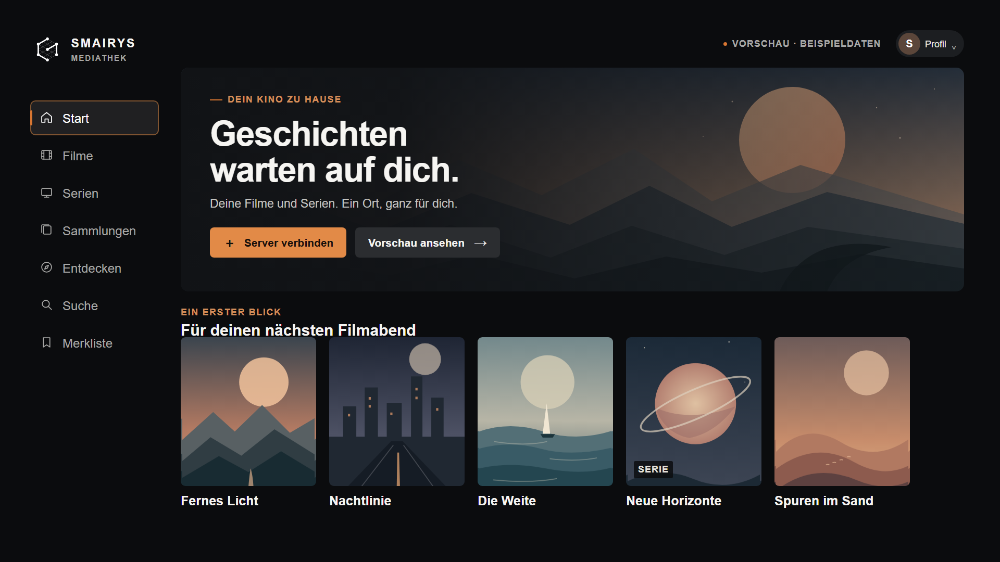

# Smairys Mediathek

**Deine freie Kinoerfahrung.** Ein eigener Jellyfin-Client für ältere Samsung Smart TVs – entwickelt für die Fernbedienung und Tizen 2.4.

> **Status:** Öffentliche Quellcode-Vorschau mit privat installierten TV-Testständen. Den aktuellen Prüf- und Gerätestand führen der [Projektkontext](docs/PROJECT_CONTEXT.md) und der [Tizen-Leitfaden](docs/TIZEN_BUILD.md).

> **Entwicklungsphase:** Das Projekt wird derzeit allein vom Inhaber entwickelt. Externe Beiträge, Issues, Pull Requests und Diskussionen werden vorerst nicht angenommen.



## Warum dieses Projekt?

Die Smairys Mediathek soll die eigene Jellyfin-Bibliothek auf dem Samsung UE65KU6099 (Modelljahr 2016) übersichtlich und bequem vom Sofa aus zugänglich machen. Jellyfin bleibt die Datenquelle für Bibliotheken, Benutzer, Metadaten und Medien. Diese App ist der TV-Client.

Nach der Anmeldung zeigt die App persönliche Filmreihen, Sammlungen, Merkliste und Besetzung. Entdecken bündelt die Film- und Personensuche mit Filtern für Status, Genre, Darsteller und Jahrzehnt. Smairys Connect ergänzt die TV-Anmeldung per QR und die Filmwahl am Handy. Persönliche Clips benötigen den lokalen Begleitdienst.

## Zielgerät

| | Ziel |
| --- | --- |
| Fernseher | Samsung UE65KU6099UXZG, Modelljahr 2016 |
| System | Tizen 2.4.0 |
| WebEngine | WebKit r152340 |
| Anwendung | Tizen Web App, Paketformat `.wgt` |
| Backend | Jellyfin |

Die Oberfläche verwendet HTML, CSS und ES5-JavaScript ohne Framework. Desktop-Vorschau ist hilfreich für Layout und Logik, bestätigt aber keine Kompatibilität mit dem TV.

## Lokale Vorschau

Mit Node.js ab Version 22 im Projektordner den Vorschau-Server starten und `http://127.0.0.1:8000/?preview=1` im Browser öffnen:

```powershell
npm run preview
```

Die eigene Jellyfin-Adresse ist editierbar. Der öffentliche Quellcode enthält keine private Servervorgabe.

Der Server läuft in dieser Entwicklungsumgebung auf demselben Computer. Im Desktop-Browser kann seine lokale Adresse verwendet werden. Vom Fernseher aus bezeichnet `localhost` dagegen den Fernseher; dort muss die vom TV erreichbare Adresse des Computers eingegeben werden. Bei HTTP werden Passwort und Token unverschlüsselt übertragen. Sitzungstoken werden für die automatische Anmeldung und gespeicherte Profile dauerhaft im localStorage abgelegt. Dieser Webspeicher ist nicht als verschlüsselte Ablage nachgewiesen. Abmelden entfernt das aktive gespeicherte Profil. Weitere Profile bleiben für den Profilwechsel verfügbar.

Für die Wiederanmeldung nutzt die App bevorzugt den gespeicherten Sitzungstoken. Scheitert das Speichern der Sitzung, versucht der Passwort-Fallback bei einer Passwortanmeldung, das Passwort im lokalen Gerätespeicher abzulegen. Dieser Speicher ist nicht als verschlüsselt nachgewiesen. „Gespeicherte Anmeldung löschen“ entfernt die gespeicherten Zugangsdaten.

Die Vorschau lässt sich mit den Pfeiltasten, Enter und Escape bedienen. Über **Profil** oder **Server verbinden** öffnest du die Verbindungseinstellungen. Die Beispielkarten lassen sich öffnen und für die laufende Sitzung merken.

In den Verbindungseinstellungen kannst du die Bewegung auf **Voll**, **Reduziert** oder **Aus** stellen. Bei langsamer Verbindungsprüfung erscheint eine dezente Ladeanzeige; die Navigation bleibt bedienbar. Details zu Verhalten und freiwilliger Diagnose stehen in [docs/MOTION.md](docs/MOTION.md).

## Prüfungen, Build und TV-Test

Für die Entwicklungsprüfungen einmalig Abhängigkeiten und Testbrowser installieren:

```powershell
npm ci
npx playwright install --only-shell chromium
npm test
```

Die Prüfungen kontrollieren unter anderem ES5-Syntax, Manifest, Dateien, Branding und wichtige Bedienabläufe in einem Desktop-Browser. Sie belegen keine TV-Kompatibilität.

`npm run prepare:tizen` erstellt unter `.build/runtime` einen bereinigten Ordner mit den benötigten Laufzeitdateien. Ein reproduzierbarer lokaler Web-Build und seine Voraussetzungen sind in [docs/TIZEN_BUILD.md](docs/TIZEN_BUILD.md) beschrieben. Auch das Web-Build-Ergebnis ist noch kein WGT.

Der geprüfte Windows-Weg nutzt eine isolierte Tizen-Web-CLI für den Build und Apps2Samsung mit einem passenden Zertifikat für das private TV-Update. Ablauf und Grenzen stehen im [Tizen-Leitfaden](docs/TIZEN_BUILD.md).

Ein lokal signiertes Test-WGT wurde auf dem UE65KU6099 installiert und gestartet. Der [Projektkontext](docs/PROJECT_CONTEXT.md) und die [Aufgaben](TASKS.md) beschreiben den Prüfstand und die offenen Schritte.

## Entwicklung und Zusammenarbeit

Der Quellcode ist öffentlich zur eigenen Nutzung vorgesehen. Während der Entwicklungsphase nimmt das ursprüngliche Projekt keine externen Beiträge an; Details stehen in [CONTRIBUTING.md](CONTRIBUTING.md). Öffentliche Repositories können trotzdem gelesen und geforkt werden.

Für die Entwicklung gelten die Grenzen des Zielgeräts: keine modernen Browser-APIs voraussetzen, bevor sie auf Tizen 2.4 geprüft wurden. Fokus und Fernbedienung haben Vorrang. Jede Aussage über Wiedergabe oder Hardware muss durch einen echten Gerätetest belegt sein.

Projektaufgaben: [TASKS.md](TASKS.md). Technischer Kontext und Architektur: [docs/PROJECT_CONTEXT.md](docs/PROJECT_CONTEXT.md). Festgehaltene Entscheidungen: [docs/DECISIONS.md](docs/DECISIONS.md). Vorgesehene Repository-Einstellungen: [docs/GITHUB_SETUP.md](docs/GITHUB_SETUP.md).

## Lizenz und Rebranding

Der App-Quellcode und die Projektdokumentation sind unter der [MIT-Lizenz](LICENSE) lizenziert. Die Smairys-Logos, das TV-Symbol und der Screenshot mit Logo im Ordner [`branding/`](branding/) gehören nicht dazu. Markenname und Slogan stehen in `branding/config.js`; die Bilder lassen sich durch eigene Dateien mit denselben Namen ersetzen. Siehe [`branding/README.md`](branding/README.md). Die MIT-Lizenz gewährt keine Rechte an Smairys-Namen oder Marken.

Heimserver und Migration sind in [HOME_SERVER.md](docs/HOME_SERVER.md) beschrieben. Die konfigurierbare Connect-Adresse erklärt [SERVER_CONNECTIONS.md](docs/SERVER_CONNECTIONS.md).
