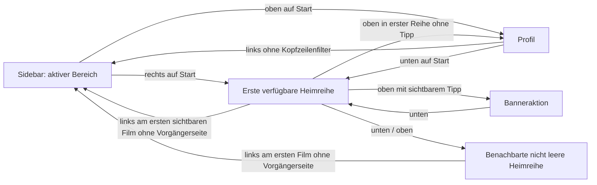
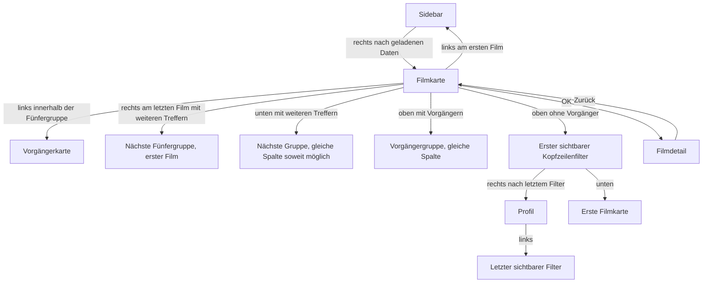
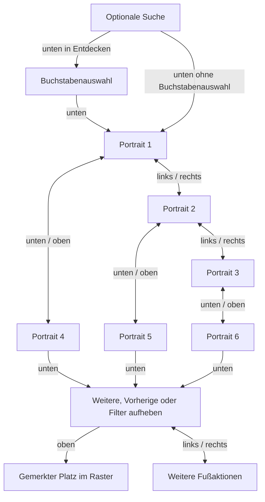
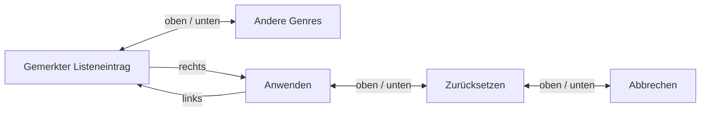
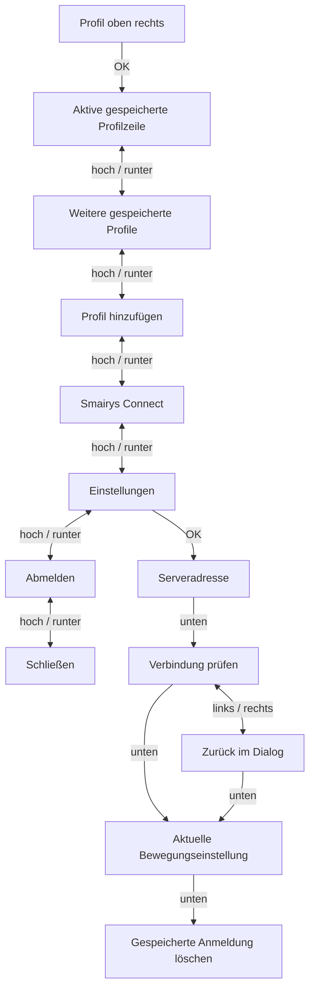
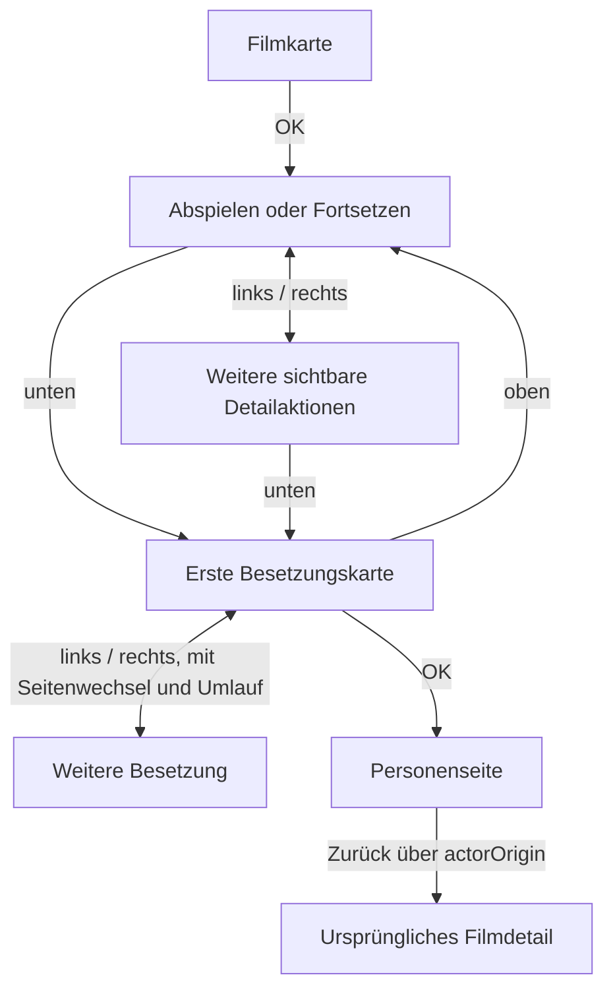

# Fokus-Maps der TV-Oberfläche

Stand: 5. November 2026, Quellstand 0.1.42. Dies ist eine Beschreibung des Ist-Verhaltens mit ausdrücklich getrennten Zieländerungen. Kein Laufzeitcode. Nach Navigationsänderungen mit `move`, dem `keydown`-Handler in app.js und den Verhaltenstests abgleichen.

**Nachweise:** B = mit Browser und Pfeiltasten beobachtet; Q = aus Quellcode abgeleitet; T = isolierter Verhaltenstest. Die Browserprüfung nutzte 1920×1080 und eine vorhandene Anmeldung. Kein neuer TV-Test, kein echter Filmstart, keine Änderung an Benutzerkonten oder Wiedergabefortschritt. Private Namen und Medien sind abstrahiert.

## 1. Hauptnavigation und Start

B: Start + oben → Profil, Start + rechts → erste Filmreihe. Auf und Ab wechseln zwischen den Reihen im begrenzten Inhaltsbereich unter der Kopfzeile. Die Rückkehr zur ersten Reihe zeigt die Begrüßung wieder. Ist eine Banneraktion sichtbar, erreicht man sie aus der ersten Filmreihe mit oben. Q: Spalte beim Reihenwechsel möglichst erhalten. Nicht vorhandene Reihen werden übersprungen. Am linken Rand einer bereits weitergeblätterten Heimreihe lädt links zunächst die Vorgängerseite. Dieser Unterschied zur allgemeinen Filmliste bleibt zu bewerten.

Sidebar hoch/runter wechselt den Fokus, OK aktiviert den Bereich. Rechts betritt den aktuell geöffneten Inhalt, aktiviert nicht automatisch die nur fokussierte andere Sidebar-Zeile. Q: `move`, `activate`, `firstHomeCard`.

## 2. Filme, Sammlungsinhalt und Entdecken

B: Filter aus Profil per links erreichbar; Sammlungsinhalt + links vom ersten Film → Sidebar. T: horizontales Weiterblättern über mehrere Gruppen, links zur Sidebar, rechts zur gemerkten Karte und Rückkehr nach Detail.

In Entdecken führt rechts von der Sidebar zuerst zu „Filme & Personen suchen“. Die Filterleiste folgt nach rechts, unten führt zur ersten Filmkarte. OK öffnet das Suchfeld. Zurück schließt die Suche, stellt die Filter wieder her und fokussiert den Sucheinstieg. Das Reset-Symbol erscheint bei geänderten Filtern oder geänderter Sortierung und gibt den Fokus nach OK an „Status“ zurück. T: `ui.test.cjs`, `discovery-integration.test.cjs`.

Status, Zeitraum und Sortierung öffnen eine vertikale Auswahl auf dem aktuellen Wert. Hoch und runter bewegen den Fokus. OK übernimmt sofort, Zurück schließt ohne Änderung. Beide Wege kehren zum jeweiligen Filter zurück.

Q: Im Bereich Filme bringt Zurück von einer Filmkarte den Fokus zur Sidebar. Im Sammlungsinhalt führt Zurück dagegen zur Sammlungsliste und zur Ursprungskarte. Auf Entdecken führt Zurück im allgemeinen Fall zu Start. **Zurück ist also aktuell nicht überall dieselbe Sidebar-Abkürzung.** Links am ersten Film bleibt der gemeinsame sichere Weg.

Q/B: Während die Karten noch laden, kann rechts von der Sidebar auf Profil ausweichen. Die gewünschte Inhaltseingabe wird nicht als verlässliche Absicht vorgemerkt. Separater Test mit verzögerter Antwort offen.

## 3. Schauspielerfilter: zwei Reihen mit je drei Karten

B/T: „Weitere“ und „Vorherige“ haben feste Plätze. OK behält den Fokus beim Blättern. Am Seitenende bleibt die Taste sichtbar und deaktiviert. Oben führt zur gemerkten Rasterposition, auf einer Teilseite bei Bedarf zur letzten verfügbaren Karte. In Entdecken ist über der ersten Reihe der Buchstabenfilter erreichbar. OK auf einem Portrait wählt den Darsteller, Escape schließt zum Filterauslöser.

## 4. Genre-Dialog

B/T: Öffnen fokussiert das erste Genre. Rechts erreicht „Anwenden“ direkt. Links aus der Aktionsspalte führt zum gemerkten Genre. OK auf einem Genre markiert die Auswahl, „Anwenden“ übernimmt sie und Escape verwirft den Entwurf.

## 5. Profil und Einstellungen

B: aktives Profil als Eintritt, anschließend Profileinstellungen sichtbar geprüft. Q: Profilaktionen sind vertikal; links/rechts bewirken dort keinen Wechsel. Die Zahl der Zeilen hängt von gespeicherten Profilen und Anmeldestatus ab. Q: Bewegung hoch → Verbindung prüfen, nicht zur zuletzt verwendeten der beiden Aktionen. Innerhalb der Bewegungsauswahl links/rechts. Löschen + oben → gewählte Bewegung.

Q: Escape schließt `connection` insgesamt über `closeConnection` und stellt den ursprünglichen Fokus wieder her; der sichtbare Zurück-Button in Einstellungen kehrt dagegen ins Profil zurück. Diese beiden Bedeutungen bei einer Überarbeitung vereinheitlichen oder bewusst erklären.

## 6. Filmdetail und Besetzung

B: Detail öffnet mit Abspielen, unten → erste Besetzungskarte; OK öffnet Personenseite. Q: Besetzung + oben führt immer zur Hauptaktion, nicht zur vorher fokussierten Nebenaktion. Links vom ersten Darsteller lädt die vorherige Fünfergruppe bzw. umlaufend die letzte; rechts entsprechend weiter. Ohne Besetzung gelten lineare Detailregeln.

Q: Detail + Zurück → Ursprungskarte. Lesedialog ist eigener Zustand; hoch/runter scrollt Text, Zurück schließt ihn. Personenseite nutzt intern Suche als Bereich; die Beschriftung „Zurück zur Suche“ ist deshalb nach Einstieg aus einem Film möglicherweise irreführend. Rückkehrfunktion separat von der Beschriftung prüfen.

## 7. Player und Anmeldung: gesonderte Prüfgrenze

Die folgenden Regeln wurden in dieser Runde nicht am echten Player oder an der TV-Tastatur bedient. Quellen: `keydown`, `showLogin`, `startLoginQuick`, Player- und Login-Tests.

- Anmeldung: hoch/runter durch sichtbare Login-Elemente. Enter auf Benutzername → Passwort; Enter auf Passwort → Anmeldung; im Serverfeld → Server speichern. QR- und Passwortpfad müssen unabhängig verfügbar bleiben. Wiederherstellung einer gespeicherten Sitzung nicht durch einen falschen Ladezustand blockieren.
- Player mit ausgeblendetem HUD: links/rechts zeigt Steuerung und springt unmittelbar ±10 Sekunden. Sichtbares HUD: links/rechts wechselt die Playeraktionen, OK aktiviert sie.
- Pause + oben → Clip-Symbol, wenn für die Wiedergabe verfügbar; Clip-Symbol + unten → Play/Pause. Ohne verfügbares Clip-Feature keine unsichtbaren Fokusziele.
- Native Spultasten starten beschleunigte Sprünge; OK oder Zurück beendet zuerst das Spulen. Reguläres Zurück beendet sonst den Player.
- Clip-Zeitlinie: links/rechts verschiebt die Auswahl, wiederholte Eingaben vergrößern den Schritt. Hoch/runter wechselt Markieren/Speichern entsprechend Bereitschaft; Zurück verlässt zuerst die Clipauswahl.

T: Login, QR-Ausfall, gespeicherte Sitzung, Profilwechsel und horizontale Playersteuerung in zehn ausgewählten Tests bestanden. Dies bestätigt keine native Videowiedergabe im Desktop und keine TV-Tastaturgeometrie.

## Änderungen prüfen

Bei einem geänderten Fokuspfad jeweils Eingang, vier Richtungen, OK, Zurück, leere Liste, letzte Teilreihe, langsame Antwort und Rückkehr prüfen. Relevante Tests: `horizontal-navigation.test.cjs`, `profiles.test.cjs`, `login-screen.test.cjs`, `player-navigation.test.cjs`, zusätzlich je nach Änderung Discovery-, Home- und UI-Tests.

Prioritäten und Akzeptanzkriterien: [TV-UX-Analyse](TV_UX_REVIEW.md).
